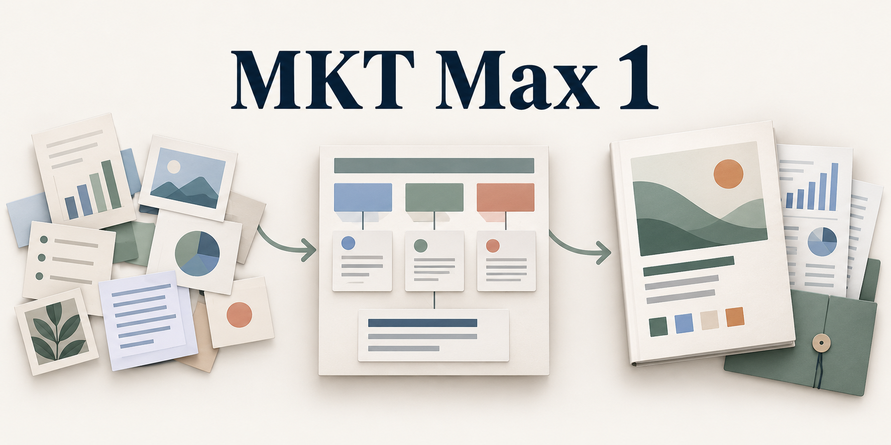

[简体中文](README.md) | [English](README.en.md)



# MKT Max 1

MKT Max 1 helps a planner develop an event idea and turn the chosen direction into a readable proposal. In the first stage, **you are the lead author**. The assistant researches the market, investigates creative leads and helps you test alternatives. In the second stage, **you commission chapters and the assistant writes them** using your original material and decisions. A local Python runtime keeps the work available across conversations.

**Experimental release candidate 1.2.0-rc.3.** The skill and its working references are primarily in Chinese. The release has three known runtime defects, including a privacy issue after rollback. [Version record](version.json) · [Known issues](#validation-and-known-issues)

## How a project moves through the two stages

| Step | What the planner does | What the assistant brings back |
|---|---|---|
| 1. Frame the assignment | Name the audience, the problem and what you need to decide or deliver now. | A short restatement in your words, what the audience already does, and the missing fact most likely to change the direction. A focused commission can end with a cost check, invitation or revised paragraph. |
| 2. Research and develop ideas | Write freely, share a fragment or ask the assistant to find an opportunity. Keep competing ideas alive when the choice is still open. | Dated sources, an observed choice or constraint, creative possibilities grounded in that evidence, and a short trial of how an idea would feel to a participant. |
| 3. Choose a direction and hand it over | Select the experience or wording you want, explain your trade-off and identify what the writer may change. | The original passage alongside your decision, its reason, rejected alternatives, unresolved conditions and the chapters this material can support. It distinguishes wording to keep verbatim, wording open to editing, intent to preserve and material to withhold. |
| 4. Write commissioned chapters | Specify the sections, audience and scope. Review the actual opening, chapter or deliverable as it becomes available. | Readable prose for the intended reader. For each chapter the assistant rereads the originals, the decision record and adjoining sections, then checks names, numbers, claims, transitions and dependencies. |
| 5. Revise and accept | When a condition changes, decide any affected business or creative question. Identify the exact text you accept. | Rechecked evidence, revised passages and a review copy. The assistant also reads the surrounding prose for implications outside the recorded dependency links. |

Three decisions can arise during this work. **A** agrees the commission. **B** selects a direction. **C** records acceptance of text someone actually read. An existing decision can be carried forward. A small request can finish at the requested output. A chosen opening can support an internal rehearsal while funding and publication remain separate decisions. Acceptance can cover a complete version, a module or a uniquely identifiable passage in the version shown. [Workflow and decisions](references/workflow-and-decisions.md) · [Authorship and chapter writing](references/author-and-chapter-writing.md)

If you commission a post-event review, the assistant compares actual attendance, participant choices, costs and unexpected effects with the original objectives. Before the event it can prepare what to observe, when and by whom. [Seven planning tasks](references/workflow-and-decisions.md)

## Research, simulation and decision owners

The event format follows what participants must actually do and which outcome the organizer would miss most. A “theatre open day” can call for three different plans. A public experience needs a visitor to hear a difference between seats. Volunteer recruitment needs a newcomer to lead a short reading and receive feedback. A recognition ceremony needs a colleague’s verified contribution and their consent to share it. When two outcomes compete for the same time or staff, the planner chooses which governs the research and first draft. [Event routing and examples](references/event-routing.md)

The assistant starts with a decision that could change. For a dated price, recruitment channel or competing event, it retrieves the current source, records the date and scope, compares it with the prior assumption and explains which choice the finding affects. Live retrieval requires search and page access from the host. Consumer simulation follows one person's choices across real alternatives, including price, time, friction and reasons to leave. Scenario rehearsal follows the people who must handle a disruption, capacity limit or handover. Simulated reactions stay labelled as hypotheses until checked against interviews, observations or records. [Dynamic research and simulation](references/dynamic-research-and-simulation.md)

| Decision | Who contributes or decides | What they see |
|---|---|---|
| Invest, defer or redirect spending | The budget holder decides. Insights and data owners check the audience, baseline and attribution. | Incremental benefit against the existing activity, competing uses of money and staff, a recommendation and the evidence that could reverse it. |
| Choose a creative direction or release a claim | The creative lead selects the experience. Brand, product or rights owners verify the specific claim. The authorized publisher decides release. | The original and trial wording, supporting source, intended audience and exact version proposed for the channel. |
| Recruit and serve participants | Sales, CRM, stores or channel owners verify matching rules, capacity, staffing and follow-up within their remit. | One example traced from entry to handover, distinguishing existing demand, additional demand and occupied slots. |
| Commit production resources or partner benefits | The producer, supplier or partner confirms what they control. The authorized project owner commits the project. | The relevant run sheet, resource or benefit, dependency, deadline and fallback. |

A department enters when its evidence or authority can resolve the current decision. For a series, the team can share an overall direction while tracking location-specific decisions and effects across dates. [Decision routing](references/event-routing.md) · [Series planning](references/series-orchestration.md)

A commissioning client might need a proposal they can read at a meeting. A producer taking over the same event might need a timed run sheet, cue, owner and fallback for each handover. Budgets, media copy, design briefs and follow-up measures enter when someone has a use for them. The bundled assembler produces Markdown. Office documents and artwork require suitable host tools and a check of the actual exported file. [Production and design handoff](references/staffing-and-design-handoff.md) · [Costs](references/commercial-and-cost.md) · [Measurement](references/measurement-and-learning.md)

## Where the planning methods come from

The skill adapts published excerpts from six event-planning books. Wang Chunlei and Chen Xiaolian connect the organizer’s purpose to observable stakeholder outcomes. Frissen, Janssen and Luijer connect the experience to participant effort, opportunity cost and the action expected afterwards. Raj and Rashid inform the comparison with competing events, willingness to pay, sponsorship and feasibility. Matthews informs supplier checks before committing to production. Su Hai distinguishes the concept proposal, budget, assignments and event-day schedule. Getz informs the distinction between an output delivered and a later outcome, including costs borne by other stakeholders. The reading guide identifies the edition, pages or preview available, source links and the specific planning action derived from each. The A/B/C decisions belong to this skill’s collaboration design. [Reading guide and source pages](references/event-planning-books.md) · [ceyuan and software provenance](references/provenance.md)

## Try it in one project

Clone the complete directory. From your agent host, point the current project at the checkout’s `SKILL.md`. Your host needs file access and local command execution to persist work. The scripts use Python 3.10+ and the standard library. [Skill entry point](SKILL.md)

```shell
git clone https://github.com/DONGaOtang/mkt-max-.git mkt-max-1
cd mkt-max-1
python --version
```

On Windows, run the following from the checkout in PowerShell. Copy the example once, then edit `workspace_root` in your personal `config.json` to an absolute folder for your projects, such as `C:/MktMaxWorkspace`. On other systems use an absolute path appropriate to your machine. [Example configuration](config.example.json)

```powershell
if (!(Test-Path -LiteralPath config.json)) {
    Copy-Item -LiteralPath config.example.json -Destination config.json
}
notepad config.json
```

```shell
python scripts/start_agent.py init --name "Demo workshop" --id demo-workshop --config config.json
python scripts/start_agent.py resume --project demo-workshop --task "Research the audience and competing events" --config config.json
```

Then ask your agent, for example, *“Use this checkout’s SKILL.md and resume demo-workshop. I’m considering an after-work workshop. Find two ways people already solve this problem and bring me a first-hand observation or a source for each. I’ll write the opening.”* Once a direction is chosen, a second request could be *“Keep my opening verbatim. Write the participant experience and staffing chapters for internal review.”*

### Persistence and reader copies

`init` creates a project and initial revision. `resume` prepares a task packet for the agent to read. The runtime stores source material, decisions, handovers, modules and revision history under the configured workspace. The agent submits changes with `writeback.py`, identifying the base revision and operation. The project hub (`项目中枢.md`) provides navigation back to the records and actual chapter text. The scripts manage files and revisions. Research and writing are done by the agent with the tools available in its host. [Runtime commands and payloads](references/runtime-protocol.md) · [Context and recovery](references/context-and-recovery.md)

For a new collaborative project, the default assembly is the internal working copy. It can include incomplete work, attachments, questions and blockers. The client view assembles current, reviewable chapters explicitly designated for the client, subject to role, dependency and blocker checks. It exports Markdown and a manifest used to identify the exact version shown. A person still checks the contents for sensitive wording and authorizes distribution. Older projects without a recorded workflow mode retain their historical assembly behavior. [Reader delivery](references/reader-delivery.md)

```shell
python scripts/assemble.py --project demo-workshop --view editor --config config.json
python scripts/assemble.py --project demo-workshop --view client --config config.json
```

## Validation and known issues

In the isolated development workspace, **76 runtime tests and 9 collaboration tests passed**. A simulated product roadshow also exercised a mid-project change. All six apparent bookings matched existing store appointments. For that batch the six slots were occupied and the incremental booking count was zero. The team reopened the funding decision, recommended retaining the store allocation and revised the budget and reception chapters. The superseded budget copy was blocked. The planner’s chosen blind-listening opening remained byte-for-byte identical for internal rehearsal. This was a simulated review with no actual spending decision or customer results. The test suite and trial workspace are development materials outside this package.

| Known defect in rc.3 | Practical handling |
|---|---|
| A public-role task packet after rollback can reveal the path to a full comparison report containing private values. | Keep the report and packet with a trusted operator. Inspect them before sharing. Role filtering operates at the application level. |
| A module update can store a new blocking question alongside a `reviewable` status. | Read the updated blockers and status together. Client assembly checks current blockers separately. |
| A newly declared unit in `module.units` can immediately be marked `stale`. | Check the affected unit and downstream handovers against their evidence before resuming work. |

Code and documentation use the MIT License. For bug reports, include the version, a minimal reproduction, and the expected and observed behavior, using sample inputs that can be shared. [License](LICENSE) · [GitHub Issues](https://github.com/DONGaOtang/mkt-max-/issues)
