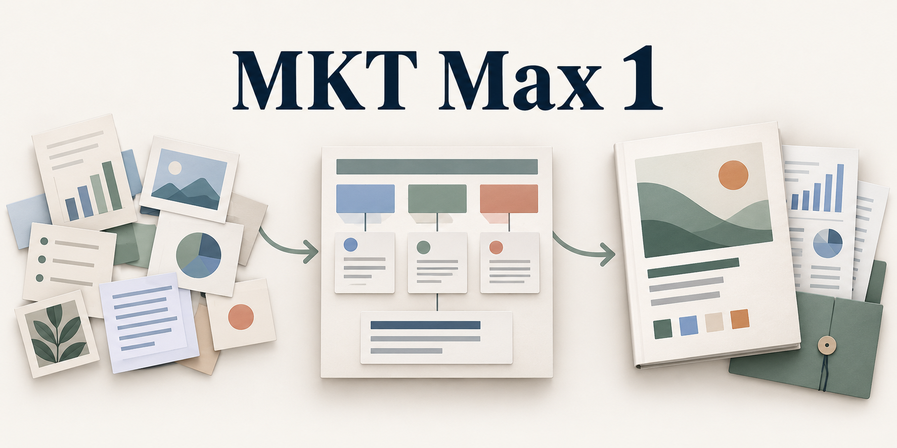

[简体中文](README.md) | [English](README.en.md)

# MKT Max 1

**一套给活动主创和策划团队使用的 Agent 技能。第一阶段你主创，助手查资料、试创意、帮你看清取舍。你把哪些章、写给谁、写到什么程度交代清楚后，第二阶段由助手逐章执笔。** 项目既可以从一句没想透的开场开始，也可以从一份待改的旧方案接手。

当前协作试用版为 **1.2.0-rc.4**。可以直接在当前项目加载。正式项目另有本地 Python 工具，保存原稿、依据、决定和历次正文，便于换人、换对话和改条件后接着写。[版本信息](version.json) · [技能入口](SKILL.md)

## 从哪里开始

| 你手上有什么 | 这一轮能拿到什么 |
|---|---|
| 一句文案、一个闪点或一个犹豫 | 一段可试读、可演、可改的文字，以及最可能失效的那个动作。单句改稿可以直接收口。 |
| 一个目标，仍在考虑要不要办 | 把办活动和维持现有做法放到相同目标、对象和时间窗口下比较，写清额外所得、挪走的资源、关键反证和翻案条件。 |
| 自己写过的底稿和几个备选 | 对照原文做研究和试写，保留并存的想法、主创的批注、取舍及理由，交一份能继续推敲的底稿。 |
| 已定的方向或要交付的章节 | 按已约定的范围，给老板能判断的提案、客户能读完的章节，或让主持、销售、设计、制作拿到就能接手的工作件。 |
| 中途改了预算、场次、人群或信息口径 | 找出被推翻的决定、章节与附件，补原件、复核、改实际段落，再查同一处改动在整稿的落点。 |

可用于线上、线下、混合、单场和系列活动。招募传播、票务赞助、销售承接、人员班次、场地制作、系列排期和复盘，各自在委托需要时展开。[活动分流](references/event-routing.md) · [面向读者的交付](references/reader-delivery.md)

## 两个阶段怎样交接

| 时点 | 人和助手分别做什么 | 留下什么、交给谁 |
|---|---|---|
| 第一阶段 · 读委托 | 主创给原话、旧稿、批注或正在犹豫的问题。助手先回交确定条件、目的理解、本轮问题，以及旧取舍的继承建议。 | 一份短简报和需要主创回答的实际问题。确认本轮范围后，开展对应研究。 |
| 第一阶段 · 研究与试写 | 助手查原件、找反例和独有原料，围绕当前构思做局部试写，再把发现带回主创。主创补稿、选择使用重点、要求补查或让方向继续并存。 | 研究发现、可用细节、实际原型、代价和翻案条件。分别保存主创亲笔段、助手试稿、证据出处及真实取舍。 |
| 接笔时 | 主创定本轮开写的章节、读者、用途和深度。助手把每章要回答的问题、调用的原段、承接的前章和交给后章的内容对好。 | 章节委托和底稿。逐段区分逐字保留、允许润色、只保留意图、弃用／暂缓／不外发。只有创意被选中时，就继续在第一阶段打磨。 |
| 第二阶段 · 逐章写 | 助手每章先回读亲笔原文、方针、依据、相邻章和最新批注，再写实际正文。默认每章交主创审阅，收到该章意见和下一步答复后继续；明确委托一组连写时，完成这组后回交。 | 体验章写参与动作，投资章写用途比较和资源代价，接待章写现场分支与交接。主创对实际章稿留、改、退回，反馈绑定所看正文与版本。 |
| 改条件与交付 | 助手检查哪些依据、决定和承诺失效，请有权者重审对应取舍，改受影响的章和附件并通读组装稿。接收者审阅实际版本，指明采纳或退回的范围。 | 给读者干净阅读稿，给编辑另备原文入口、待改和复核记录。写成、采纳、外发、实施和实绩各有各的证据。 |

全案保留 **A 委托、B 方向、C 审阅** 的主线，并把每次回交的材料和放行范围写实。研究发现由主创决定怎样使用，方向选定后还需明确接笔委托。默认逐章审阅，明确的章节组委托可以覆盖连续写作。每个节点都留真实答复、所看内容、范围和本轮协作归属。[协作工作与人工节点](references/workflow-and-decisions.md) · [主创底稿与逐章写作](references/author-and-chapter-writing.md)

| 人工节点 | 人看到什么 | 答复开放的工作 |
|---|---|---|
| 本轮委托与重启范围 | 短简报、继承建议和关键问题 | 按确认的重点研究和整理 |
| 研究发现回交 | 原始细节、反例、使用建议和局部试写 | 主创补稿，指定发展、补查或继续探索的线索 |
| 创意与取舍 | 可以试读的片段、差异及代价 | 深化实际选中的部分，保留暂缓与弃用理由 |
| 接笔委托 | 原文、编辑权限和章节安排 | 只写明确委托的章、读者用途和深度 |
| 章节与整稿审阅 | 实际章稿或完整阅读稿、待改及条件 | 按留改意见修订，继续获托的下一章或章节组，记录实际采纳范围 |
| 条件变化后的重审 | 新旧条件、受影响段落与改法 | 重作受影响取舍，保留本轮仍成立的内容 |

已经明确的本轮答复按原范围采用。用户直接要求“把第二段压短”就可以完成这次改稿，检索、核算、存稿和整理在委托内持续进行。单句、单模块和纯研究任务可以在对应成果处收口。人的采纳与后续发布、采购、实施各有实际授权和回执。

如果委托还包括活动后的复盘，助手会用实际到场、退出、成本和意外影响对照最初目标。活动前可以先约定谁在什么时候记录什么。

### 哪个职能什么时候介入

按**本次要作的决定**找人。同一个新品路演里，创意、预算、产品主张和接单可以分别处于不同状态。下表角色按实际组织里的权限对应。

| 待决定的事 | 给谁、看什么 | 能定到哪一步 |
|---|---|---|
| 开场值不值得保留 | 给主创一幕能试演的开场、参与者可能停在哪一步、改法与代价 | 选表达和体验，可先内部试演 |
| 是否从门店调一笔钱办路演 | 给市场负责人或预算持有人看同资源留店的结果、新增依据、抽调损失、成本与报价 | 决定拨款、保留预算、缩小试验或暂缓 |
| 一句产品说法能否上物料 | 产品或技术核原始测试及适用条件，品牌或相应权利人审实际措辞、素材权利和渠道 | 在各自权限内确认事实、允许的表达与发布用途 |
| 预约能否算新增、能否接待 | 销售或渠道看原名单、时间、去重规则、可用席位和具体转交样例 | 确认归属、接收或候补，提供预算判断所需的依据 |
| 合作方承诺或现场动作能否兑现 | 合作方、制作或现场负责人看权益清单、资源量、时间线、报价或故障替代动作 | 只确认自己能提供的资源、履约条件或应急安排 |

## 动态信息、消费者模拟与场景推演

- **动态检索**从“这条信息不同，会改哪项决定”起步。查当期原件，记取得时间、适用范围和冲突来源，给出重查时点。例如票价、名额、报价、渠道规则或旧客户底表有变，回到有权来源再查，把变化落到相关段落。
- **消费者模拟**给具体参与者一个场景，走过看到邀请、比较其他选择、投入时间或钱、参加或退出、离场后行动的过程。把犹豫、放弃和替代路径带回创意设计。推演结果标为假设，真人观察与实际业务记录单独保留。
- **场景推演**沿真实岗位和时间线走一遍。例如满席后谁查看原约、谁说明候补、谁交接、超时怎么办。改一个条件，用同样的动作重走，检查人员、容量、文字和承诺能否同时成立。

搜索和页面读取取决于宿主提供的工具及可访问资料。关键原件拿不到时，助手写明结论的范围、缺什么和如何补核。脚本只处理本地项目记录；定时监测和行动结果需要另外安排。[动态研究与推演](references/dynamic-research-and-simulation.md) · [研究与证据](references/research-and-evidence.md)

### 六本行业书具体用在哪里

| 可核对的书籍 | 对应的策划动作 |
|---|---|
| 王春雷、陈小连《活动管理原理、方法与案例》 | 分开写主办方、付费方与参与者各要什么，用可观察的结果解释办活动的理由。 |
| Frissen、Janssen、Luijer，*Event Design Handbook* | 从离场后要发生的行为倒推体验，计算参与者的准备时间和放弃的其他选择，也检验区域团队能否接手。 |
| Raj、Rashid，*Events Management: Principles and Practice* | 比较同类活动、到场时点、愿付价格与渠道，分辨赞助方目标，核对实际承诺和投入可行性。 |
| Matthews，*Special Event Production: The Process* | 在创意阶段向制作方核可行性和初估，经授权实施后再细化协调、搭建、运行和撤场。 |
| 苏海《活动策划实战攻略》 | 总体方案、预算、分工和当日流程分别服务不同读者，按用途写成各自能用的文件。 |
| Getz，*Event Evaluation* | 分开统计到场等即时产出与后续行为变化，查找意外影响和由其他人承担的成本。 |

仓库记录了采用的具体章节、页码、公开样章或试读入口，以及每条方法的使用边界。人工节点与两阶段交接来自本项目的协作设计。[行业书页与用法](references/event-planning-books.md) · [ceyuan 系列及工具方法来源](references/provenance.md)

## 在当前项目试用

把完整仓库放进项目，向宿主 Agent 指明其中的 `SKILL.md` 即可。例如在项目目录执行下列命令，或下载仓库归档并解压。

~~~shell
git clone https://github.com/DONGaOtang/mkt-max-.git mkt-max-1
cd mkt-max-1
~~~

只做一轮创意推敲时，可以直接说：“读取本项目 `mkt-max-1/SKILL.md`。我只想打磨这个开场。请保留我标出的原句，给我一段可以现场试演的改稿。”宿主已按自身规则发现技能时，也可用 `$mkt-max-1` 调用。

### 正式项目的本地记录

运行工具使用 **Python 3.10 或以上版本的标准库**。在仓库根目录把配置样板另存为 `config.json`，将 `workspace_root` 的占位符改为自己的绝对工作目录，例如 Windows 的 `C:/MktMaxWorkspace`。个人配置由 Git 忽略。[配置样板](config.example.json)

~~~shell
python scripts/start_agent.py init --name "新品路演" --id roadshow-demo --config config.json
python scripts/start_agent.py resume --project roadshow-demo --config config.json
~~~

`init` 创建本轮协作项目；`resume` 返回当前版本、协作轮次和任务包路径，供助手回读原始资料、实际答复及现有正文。主机将 Python 3 命名为 `python3` 时，替换命令开头即可。助手负责检索和写作。有权者的实际回复才是授权依据。

| 操作 | 何时使用 |
|---|---|
| `scripts/writeback.py` | 用原件与实际文件登记来源、委托、交接、章节、变更或评审。回写用当前版本和操作 ID 绑定，同一请求可重试，版本冲突后重新比较内容。 |
| `scripts/assemble.py` | 已有符合条件的章节时，按委托组装 Markdown。`--view client` 给接收者阅读，`--view editor` 给编辑校读。 |
| `scripts/cost_check.py` | 检查已登记费用的结构和算术。价格与承诺仍需查报价原件。 |
| `scripts/rollback.py`、`scripts/repair.py` | 前者用祖先版本的内容生成新版本并留差异，后者重建中枢等派生文件。回滚后的报告需按下述已知问题核对。 |

~~~shell
python scripts/assemble.py --project roadshow-demo --view client --config config.json
python scripts/assemble.py --project roadshow-demo --view editor --config config.json
~~~

以上组装命令适用于已经写入正文的项目。新项目登记当前协作轮次，正式章节写入核对委托、研究取舍、方向、交接和覆盖该章的接笔范围。内部 `draft` 可以直接回交章审，按实际正文与所看版本记录继续或修改意见。项目原件和历史位于配置工作根下的 `projects/<项目 ID>/`。技能包包括 22 份按需参考、6 个命令入口和 1 个运行实现。Word、PPT 或设计源文件的制作取决于宿主另备的工具。[运行协议、回写字段和章审](references/runtime-protocol.md)

### 旧案怎样从头来过

旧项目可以读取和回查。使用 rc.4 重新委托、重做方向或继续正式产出时，先用 `reopen` 建立新的协作轮次，回到研究和本轮委托确认。旧原件、历次稿件、真实业务事实和外部事件继续保留。旧方向和开写范围按本轮继承意见核对。只在任务说明里写“回到第一阶段”，不足以改变项目的工作模式。

先由助手把主创的实际重开请求保存并登记为来源。下例把 `CURRENT_REV` 换成 `resume` 返回的当前修订，`RestartRequest` 换成已登记的请求来源 ID，文件路径指向这份实际原话。

~~~shell
python scripts/start_agent.py reopen --project roadshow-demo --base CURRENT_REV --operation-id restart-001 --file restart-request.md --source-id RestartRequest --reason "重新讨论活动方向" --config config.json
~~~

用户明确保留某个模块时，可按实际对象增加 `--retain-ref module:Opening`。重开后由助手整理继承范围、保存当前委托，记录本轮研究使用、方向及接笔答复，再写受托章节。原句、采纳范围和新条件仍需按本轮用途核对。[旧案重开与轮次记录](references/runtime-protocol.md)

## rc.3 新品路演试用结果

以下为 **1.2.0-rc.3** 的既有试用记录。模拟主创选定了“让人闭眼分辨两代机器”。老板要决定是否把门店预算转给路演，销售最初提供六笔标有“路演”的试预约。第一阶段保留了开场，也指出六笔与门店底表尚未比对。随后按单独委托写成三章，分别给老板判断预算、给带领人试演开场、给工作组准备传播与接待。

| 中途改变条件 | 实际阅读稿的变化 |
|---|---|
| 销售逐笔确认，六笔分别对应六个在先的门店预约 | 旧预算稿被阻止组装。第一章从“新增未知，补底表再判断”改为“本批新增为 0，六席均已被原约占用”，建议继续门店排期，并写明何种新证据值得再次提请预算持有人决定。 |
| 原约和新需求需要不同接待动作 | 第三章写明如何把已匹配的预约并回原时段、满席时怎样候补、原约待核时由谁跟进。海报用语维持原来的使用边界。 |
| 预约归因改变，内部开场仍可试演 | 第二章可单独组装，终稿与初稿逐字节一致，保住了主创的选择。 |

这次试用使用模拟品牌、预约和职能回复，实际完成了文件比对。33 次运行库操作中有 32 次成功，另一次按预期拦住了旧预算稿。预算拍板、客户反应、对外发布和销售效果均需真实项目另行验证。本地回归记录为 **85/85**，其中原运行库 76 项、协作流程 9 项。

rc.4 在隔离开发工作区完成 **99/99** 项回归，包括运行库76项、协作流程9项、人工节点14项，均无跳过。新增验证覆盖真实旧版本存档重开、研究回交、接笔范围、逐章与批量审阅、当前正文指纹、跨轮回滚和混合权限授权。四组执行前后运行库及测试文件指纹一致。独立模型的首轮重开样本也回交范围并停下来提问。测试与试用记录保存在开发工作区，结论覆盖合成输入下的程序和模型行为。

### 当前版本的已知问题

| 问题 | 使用时怎样处理 |
|---|---|
| 回滚差异报告的权限传播有缺口 | `public` 任务包可能给出含私有值的完整报告路径。完整报告留在主控范围，向其他角色分发回滚后的任务包前须核查。文件系统权限另行设置。 |
| 同次模块提交可能同时得到 `reviewable` 和新的 `blocking` 未决 | 程序先检查原有未决，再写入本次新增项。提交后核对全部阻断和实稿，再判断能否交付。 |
| `module.units` 同次写入可能被误标为 `stale` | 新建单元及下游可能被阻断，应核原件、实际单元和登记依赖，按原因修订。 |

此外，程序只能机械检查已登记的依赖。正文在别处复用了同一事实或承诺，仍需要通读整稿定位。历史盲稿对应关系与任务包分页计数也各有验证边界，当前回归数字不能用来推断市场效果或节省的 token 比例。

导出的 Markdown 是阅读副本，再次组装会按已登记正文生成。人在副本或外部原稿中直接改字后，助手应先保存修订原件，再回写对应章节，使改动进入当前版本。Word、PPT 的原位批注与往返合并依实际宿主工具核验。

采用 [MIT 许可证](LICENSE)。
